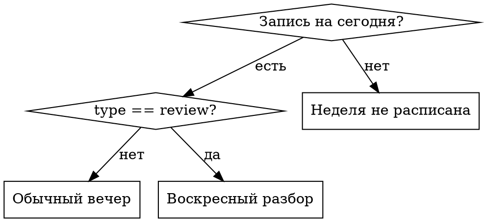

# Вечер

Ведёт один рабочий вечер под главную цель `Personal/Jarvis/GOALS.md` (150 000 ₽ до 25.12.2026). Александр (на Kwork аккаунт Ashfall, оформлен на другое имя, см. память) открывает сессию, пишет `/vecher`, дальше вечер ведёшь ты.

**Принцип: он не должен решать, чем заняться.** Он устал после дня. Твоя работа это сказать что делаем, открыть нужные файлы и сделать свою половину. Список задач уже есть, спрашивать "чем займёмся" нельзя.

## Файлы

| Файл | Что в нём |
|---|---|
| `Personal/Jarvis/plans/vechera.json` | Задачи по вечерам, ключ это дата `YYYY-MM-DD`. Единственный источник правды |
| `Personal/Jarvis/income.md` | Журнал доходов, контрольные точки, воскресный разбор |
| `Personal/Jarvis/plans/2026-q4-150k.md` | Полный план: линии, каналы, ритм, риски |
| `Freelance/vizitka-landing-pages/sales/` | Тексты кворков, KWORK-PLAN.md, PORTFOLIO.md |

## Ход вечера

1. Узнай сегодняшнюю дату (`date +%F`), прочитай `vechera.json`.
2. Найди запись на сегодня и разветвись:

3. **Обычный вечер.** Покажи коротко: номер вечера, задачу, что делаешь ты, что делает он, критерий готовности. Потом сразу начинай свою часть, не жди подтверждения. Его часть это всегда ручные действия на площадках, твоя это файлы, тексты, картинки, код.
4. **Приоритет выше плана:** если пришёл оплаченный заказ, вечер уходит на заказ. План подождёт, деньги нет. Скажи это вслух и перепиши остаток недели.
5. **Закрытие вечера.** Всегда, даже если сделали половину:
   - Запиши в `income.md` заработанное за вечер, если что-то пришло.
   - Проставь в `vechera.json` `"сделано": "что реально закрыли"` в сегодняшней записи.
   - Закоммить изменения в оба затронутых репозитория.
   - **Синхронизируй на VPS, если правил `vechera.json`:** `scp D:/Projects/Personal/Jarvis/plans/vechera.json scout-vps:/home/agent/beregi-vremya-bot/vechera.json`. Без этого бот в 19:00 пришлёт вчерашние задачи.

## Воскресный разбор

Вместо задач:

1. Посчитай заработанное за неделю по `income.md`, сравни с ближайшей контрольной точкой из плана.
2. Назови отставание или опережение в процентах. **Если отставание больше 20%, не предлагай работать больше.** План пересматривается через цену или срезание линии, это записано в плане и в GOALS.md.
3. Распиши вечера следующей недели прямо в `vechera.json`, опираясь на то, что реально произошло, а не на то, что было задумано в сентябре.
4. Закоммить и обязательно `scp` на VPS.

## Неделя не расписана

Записи на сегодня нет. Не выдумывай задачи из плана молча: скажи, что неделя не расписана, и предложи расписать её сейчас за 15 минут. Дальше как в воскресном разборе, пункты 3 и 4.

## Частые ошибки

| Ошибка | Что вместо |
|---|---|
| Спросить "чем сегодня займёмся" | Список уже есть. Открой его и веди |
| Забыть `scp` после правки `vechera.json` | Бот на VPS не видит диск, напоминание уедет старое |
| Предложить догнать отставание часами | Только цена или срез линии, см. правило в плане |
| Уйти в улучшение инфраструктуры | Спроси вслух, какой заказ это закрывает. Обычно никакой |
| Закрыть сессию без записи в `income.md` | Незаписанный вечер через неделю не восстановить |
